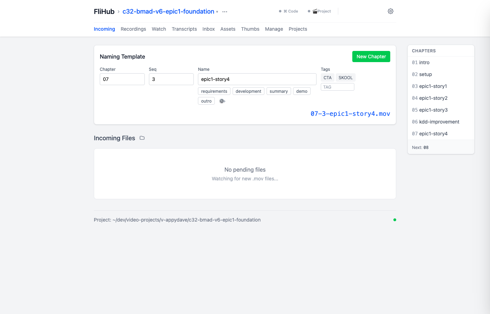

# FliHub

**The watcher behind Ecamm Live: every take you record lands in a queue, and the ones you keep become
named, transcribed recordings in the right video project.**



Stop recording and the take appears in **Incoming**. If it doesn't match the project's declared
aspect, for example a portrait feed boxed inside a landscape canvas, FliHub says so loudly, so you
can re-record straight away. Pick a chapter and a name, and FliHub moves the take into the project's
recordings folder as `07-3-epic1-story4.mov` and queues a transcript through FliTools, the suite's
one transcriber (FliHub no longer runs Whisper itself). Each Incoming card offers **Rename · Keep** (the other
incoming files stay) and **Rename · Discard** (the others go to trash). A recording container is `.mov` (Ecamm) or
`.mp4` (the Cap screen recorder's export) by default.

The other tabs work on the promoted files: **Recordings**, **B-Roll**, **Watch**, **Transcripts**, **Inbox** (send
several takes in as segments of one recording, with undo), **Assets**, **Thumbs**, **Export**, **Projects** and
**Config**, plus **Mockups**, **Mic Check** and an **API Explorer**. On a recording you can redo its transcript, tag
it, and renumber the set 1..N. The header always shows the project's trash (count and size), and you can empty it at
any time.

FliHub is the capture end of the FliVideo suite. It reads brands and projects through
[`@flivideo/core`](https://github.com/flivideo/fli-core), and FliStudio can open it on a project.
The edit happens downstream, in FliCut and FliEdit. On an Incoming take, the purple **B-roll** button instead registers a
copy with **B-roll Pilot** (FliStudio's B-roll extension) and clears the take from Incoming (the original goes to the
project's `-trash/`, recoverable).

## Run

```bash
npm install
cp server/config.template.json server/config.json   # first run only: set watchDirectory + projectsRootDirectory
npm run app                                          # detached (scripts/app.sh); also app:status, app:stop, app:restart, app:open, app:logs
open http://localhost:5100                           # or run `overmind start -D` yourself
```

**Needs:** macOS · Node ≥ 20 · npm · [Overmind](https://github.com/DarthSim/overmind) (tmux) · ffmpeg
and ffprobe · the **FliTools** service on 127.0.0.1:7161, which must be running for transcripts (nothing else
transcribes; there is no `mlx_whisper` step on this machine) · SSH access to GitHub, because the lockfile fetches
`@flivideo/core` over git+ssh · **Ports:** UI :5100 · API :5101

> [!WARNING]
> Check whether FliHub is already running first (`overmind ps`, or `lsof -i :5101`). The server kills
> whatever holds its port on startup, so a second launch takes down the running one. Launch modes and
> recovery are in [CLAUDE.md](CLAUDE.md) → _Dev Server Management_.

Change settings in the **Config** panel rather than in `server/config.json` while the server is
running. The server keeps config in memory and rewrites the file on every change.

## Open it on a project

FliHub follows the suite's open contract. You point it at a **brand** and a **project**, and
optionally a **video** (a kebab name), through any of three doors: the picker in the UI, launch
arguments, or the API. All three run the same `applyContext` on the server.

```bash
./start.sh --brand appydave --project b85-demo --video intro      # or FLIVIDEO_BRAND / _PROJECT / _VIDEO
curl -X POST localhost:5101/api/context -H 'content-type: application/json' \
  -d '{"brand":"appydave","project":"b85-demo"}'                  # GET /api/context reads it back
```

The shared rules and refusal codes live in fli-core's mirror
([fli-core's `docs/schema-mirror.md`](https://github.com/flivideo/fli-core/blob/main/docs/schema-mirror.md));
FliHub's copy is `ContextRefusalSchema` in [docs/schema-mirror.md](docs/schema-mirror.md). How FliHub
differs:

- It never sends `not-a-project`. A plain folder with no `fli.studio.json` is accepted as
  `membership: "folder"`.
- It never sends `video-not-found`. The video is carried along, not checked against `videos/`.
- **A refused launch keeps the previous project open**, so check `refused` before trusting
  `context`. This is on purpose: clearing it would wipe a saved pick because of a typo.

## Ask it what it can do

FliHub has the first slice of the suite's describe door: **`GET /api/describe`** (`describe/1`) and a JSON-RPC
**`POST /api/rpc`** with one verb so far, `system.status` (read-only, loopback). It does **not** yet draw a `/map` or
expose its capabilities as verbs. The working surface is still its HTTP API on :5101 (for example `GET /api/context`,
above); the routes live in `server/src/` and the data shapes in [docs/schema-mirror.md](docs/schema-mirror.md).

## Docs

| Read                                                                        | For                                                                                                       |
| --------------------------------------------------------------------------- | --------------------------------------------------------------------------------------------------------- |
| [docs/SYSTEM.md](docs/SYSTEM.md)                                            | How FliHub works: abstractions (incl. the hub/legacy project layout), workflows, decisions, failure modes |
| [docs/AGENT-NOTES.md](docs/AGENT-NOTES.md)                                  | What an agent working here must know that the code cannot tell it                                         |
| [docs/schema-mirror.md](docs/schema-mirror.md)                              | Every type, schema and closed set, generated from the code with `file:line`                               |
| [docs/rebuild-2026/](docs/rebuild-2026/README.md)                           | The rebuild: North Star, roadmap, requirements archaeology                                                |
| [docs/kdd/](docs/kdd/)                                                      | Learnings and patterns earned in this repo                                                                |
| [docs/backlog.md](docs/backlog.md) · [docs/changelog.md](docs/changelog.md) | Requirements (FR/NFR) and what shipped                                                                    |
| [CLAUDE.md](CLAUDE.md)                                                      | Operating rules, launch modes, machine inventory                                                          |

Test with `npm test` locally. CI can't fetch `@flivideo/core` (it has no SSH key), so a red CI badge
says nothing about a change. The one-shot server run is in AGENT-NOTES.

## Suite

Part of the FliVideo suite, mapped at [flivideo/flivideo](https://github.com/flivideo/flivideo#readme). Shared contract:
[`@flivideo/core`](https://github.com/flivideo/fli-core). Siblings: FliStudio · FliCut · FliCast ·
Teletubby · FliEdit.

## Status

**Active, in daily use.** Checked against the code at `9ed6aab` (2026-11-24). The B475 rebuild has run in place, as a series
of cuts and contract adoptions: relay and git sync are gone, and transcription moved to FliTools (B584).
Recent work is features and fixes from real recording days. The rebuild's plan and audit:
[docs/rebuild-2026/README.md](docs/rebuild-2026/README.md).

Public repo `flivideo/flihub` · [MIT](LICENSE) · David Cruwys
